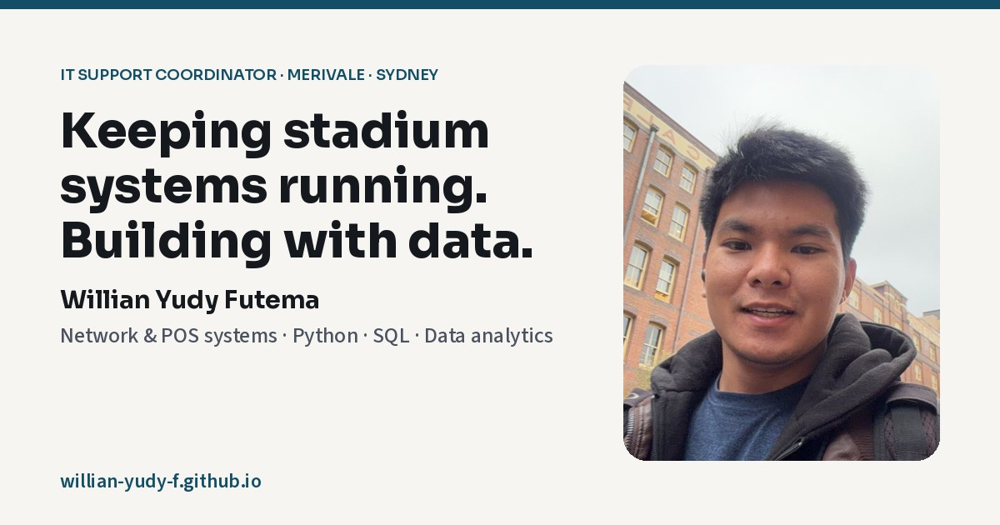

# Willian Futema — Portfolio

Personal portfolio for **Willian Yudy Futema**, an IT Support Coordinator in Sydney working with high-volume venue systems, networks, POS operations, automation and data.

**Live site:** [willian-yudy-f.github.io](https://willian-yudy-f.github.io/)



## Why this site exists

The portfolio connects two parts of my experience:

- keeping business-critical technology running during live stadium events;
- building practical software, data and AI projects from real operational problems.

It is designed for recruiters, hiring managers and technical collaborators who need a quick view of my work, evidence and career story.

## Featured work

- **FIEL** — verifiable AI-generated football intelligence with deterministic evidence checks.
- **Taropeuta Flow** — a human-reviewed AI workflow for social enquiries and client operations.
- **FielCup** — a reproducible World Cup forecasting engine using Python, SQL and Monte Carlo simulation.
- **Wine Dex** — a mobile-first wine journal built as an offline-capable JavaScript PWA.
- **Enterprise Network** — a five-router, ten-LAN network designed in Cisco Packet Tracer.

## Technical approach

- Semantic HTML with keyboard-accessible navigation
- Responsive CSS without a framework or build step
- Vanilla JavaScript for motion, project interactions and progressive enhancement
- Three.js for the scroll-driven stadium scene
- Reduced-motion support for users who disable animation
- GitHub Pages for static hosting

## Run locally

No dependencies or build tools are required.

```bash
git clone https://github.com/Willian-Yudy-F/Willian-Yudy-F.github.io.git
cd Willian-Yudy-F.github.io
python3 -m http.server 8000
```

Open `http://localhost:8000` in a browser.

## Repository structure

```text
.
├── index.html                         # Page content, styling and interactions
├── photo.jpg                          # Profile photograph
├── og.jpg                             # Social sharing preview
├── Willian_Yudy_Futema_CV_2026.pdf   # Downloadable CV
└── old/                               # Previous design kept for reference
```

## Accessibility and performance

The site includes a skip link, visible keyboard focus, semantic headings, descriptive alternative text and a reduced-motion mode. The main content remains readable without JavaScript; project links are repeated in a static featured section.

Third-party scripts and fonts are loaded from public CDNs. A future iteration may self-host these assets and split the single-page source into separate CSS and JavaScript files.

## Project status

Published and actively maintained. Content is updated as new projects and professional milestones are completed.

## Contact

- [LinkedIn](https://www.linkedin.com/in/willian-yudy-futema/)
- [GitHub](https://github.com/Willian-Yudy-F)
- [Portfolio](https://willian-yudy-f.github.io/)

